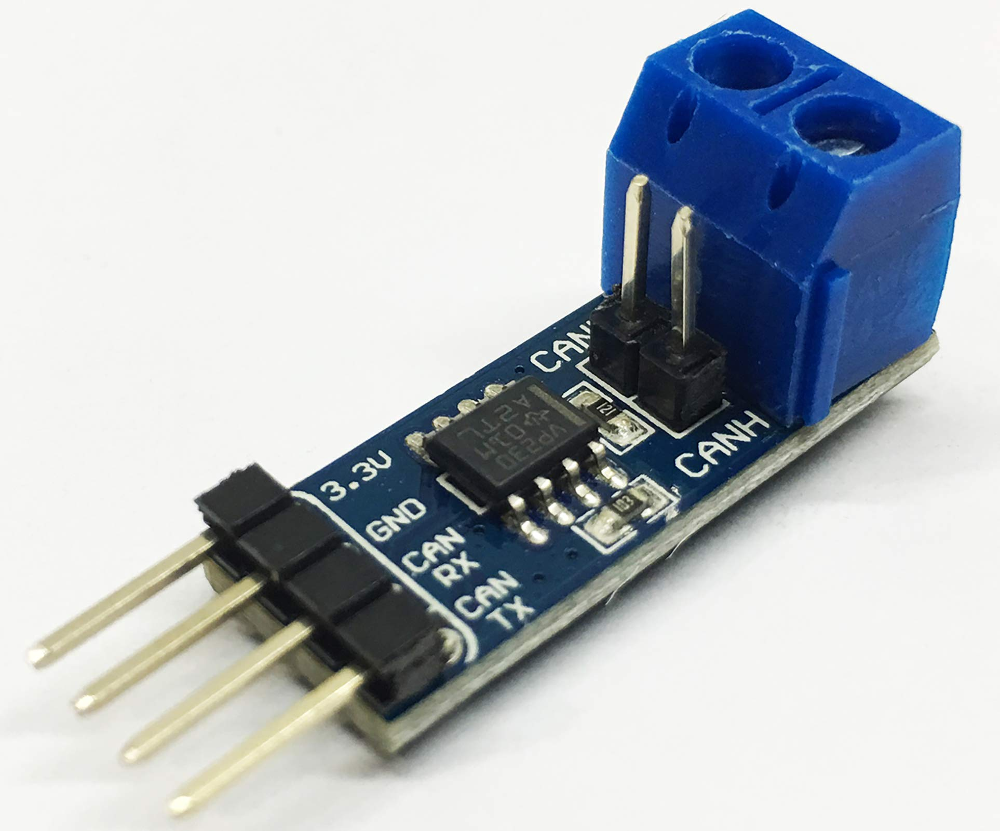
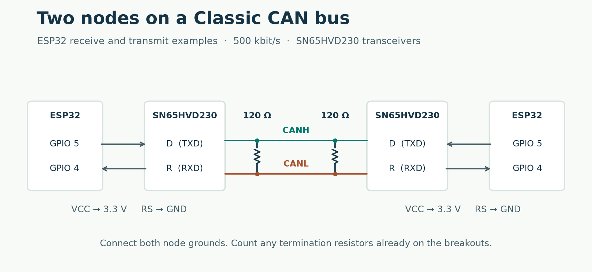

# Classic CAN on ESP32 with an SN65HVD230

An ESP-IDF component for sending and receiving Classic CAN frames. The ESP32’s TWAI peripheral handles the CAN protocol. The TI SN65HVD230 transceiver connects that controller to the CANH and CANL wires. Use the polling API for a simple node or route incoming identifiers to callbacks on a shared bus.

**Contents** · [Hardware and compatibility](#hardware-and-compatibility) · [Receive your first frame](#receive-your-first-frame) · [Example directory](#example-directory) · [Reference](#reference)

## Hardware and compatibility

| Item | Requirement |
| --- | --- |
| Controller | An ESP32 target with TWAI, running ESP-IDF 5.x |
| Bus interface | One 3.3 V CAN transceiver per node |
| First bench test | Two nodes set to the same bitrate, with a 120 Ω terminator at each end of the bus |
| Multiple buses | ESP-IDF 5.2+ within the 5.x series, a chip with multiple TWAI controllers, and one transceiver per bus |

Physical hardware validation is pending. Check the breakout’s pin labels and onboard termination before connecting it. [Transceiver datasheet](doc/sn65hvd230.pdf)

## Receive your first frame

1. From an ESP-IDF application folder, run `git clone https://github.com/JonasAtelier/esp-sn65hvd230-can.git components/hvd230_can`. Use the [receive example](examples/basic_receive.c) as your main component’s `app_main` source.
2. For that example, connect transceiver **D → GPIO 5** (TX), **R → GPIO 4** (RX), VCC to 3.3 V, and GND and RS to ground. Connect CANH and CANL to their counterparts on the second node and use a shared ground. [Wiring and termination](CAN.md#wiring)
3. Set the second node to **500 kbit/s** and have it transmit a frame. A second ESP32 can run the [transmit example](examples/basic_transmit.c).
4. With the receiver connected by USB, run `idf.py build flash monitor` from its application folder. Look for the frame type, hexadecimal ID, and payload. A quiet bus produces no frame lines. If you expect traffic and see none, check both bitrates, wiring, and termination first.

## Example directory

| I want to… | Start with |
| --- | --- |
| Read or send one frame | [Polling receiver](examples/basic_receive.c) · [Transmitter](examples/basic_transmit.c) |
| Handle only the identifiers my application uses | [Callbacks](examples/callbacks.c) · [Filtering guide](CAN.md#filtering-and-callbacks) |
| Detect a bus fault and recover | [Health monitoring](examples/callbacks_health.c) · [Recovery guide](CAN.md#bus-off-recovery) |
| Connect two separate CAN buses | [Dual-controller example](examples/dual_channel.c) |

## Reference

[Public C API](include/hvd230can.h) · [Driver reference and limitations](CAN.md) · [MIT license](LICENSE) · [Jonas Atelier library index](https://github.com/JonasAtelier/jonas-atelier-libraries#library-search)
